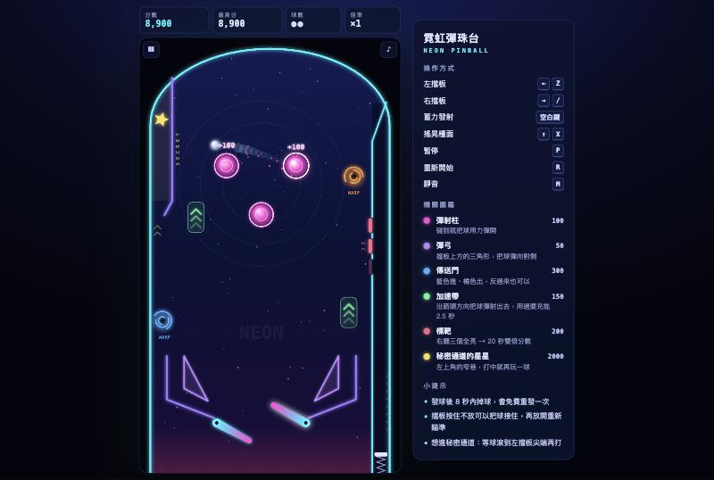

# 霓虹彈珠台 Neon Pinball

用 Vibe Coding 做的網頁彈珠台小遊戲，整個遊戲只有一個 `index.html`。

**▶ 線上試玩：https://datafox-tw.github.io/neon-pinball/**

## 怎麼玩

| 動作 | 按鍵 |
| --- | --- |
| 左 / 右擋板 | `←` `→`（或 `Z` `/`） |
| 發射 | 長按 `空白鍵` 蓄力，放開發射 |
| 搖晃檯面 | `↑` |
| 暫停 / 重新開始 / 靜音 | `P` / `R` / `M` |

手機可以直接用畫面下方的三顆按鈕。

機關有傳送門、加速帶、標靶，以及左上角打中就能「再玩一球」的秘密通道。

完整規格與開發過程的調整紀錄請見 [SPEC.md](SPEC.md)。
